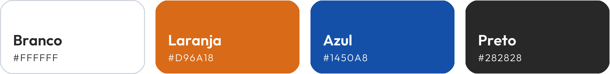
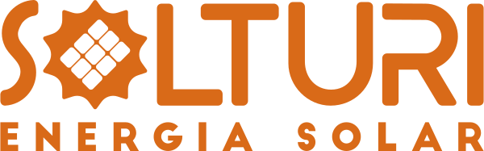
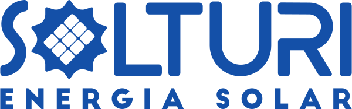

  

<h3 align="center">Economia além da conta</h3>

  Organização oficial da <strong>Solturi Energia Solar</strong> no GitHub.

---

### Identidade visual

| Elemento | Uso |
|---|---|
| **Laranja** `#D96A18` | Cor de destaque e ações |
| **Azul** `#1450A8` | Cor institucional da marca |
| **Preto** `#282828` | Sobriedade, comunicação empresarial |
| **Branco** `#FFFFFF` | Fundo e marca sobre cores |
| **Outfit** | Família tipográfica |

A marca é usada monocromática: **laranja ou azul** sobre fundos claros e **branca** sobre fundos escuros ou coloridos.

  
  &emsp;&emsp;&emsp;
  

